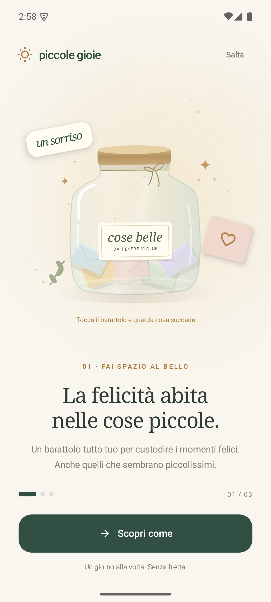
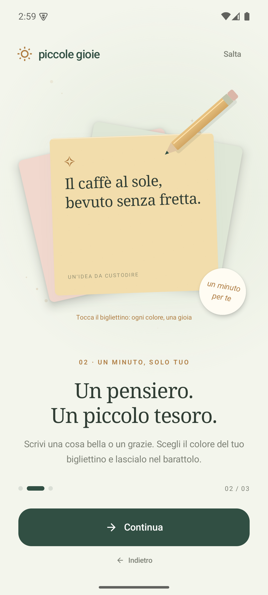

<p align="center">
  
</p>
<h1 align="center">piccole gioie</h1>
<p align="center">Le cose piccole fanno i giorni grandi.</p>
<p align="center">
  <a href="https://github.com/carellice/piccole-gioie/releases/latest">Scarica per Android</a> ·
  <a href="#pubblicare-un-aggiornamento">Pubblica una release</a>
</p>

Un barattolo della felicità **nativo Android**, scritto in Kotlin e Jetpack Compose. Scrivi ogni giorno un momento felice o di gratitudine, custodiscilo e ritrovalo quando ne hai bisogno. Crema e verde bosco, vetro, sughero e bigliettini di carta, con animazioni e piccoli gesti da scoprire.

<p align="center">
  
  
  
</p>

## Dentro il barattolo

- Scrittura minimale: testo e foglietti colorati da sfogliare con un carosello.
- Solo l’anno nei ricordi e nel riepilogo, con conteggio dei momenti custoditi.
- Tema chiaro e scuro automatico, seguendo il dispositivo.
- Un ricordo a sorpresa toccando il barattolo o «Ho bisogno di un sorriso».
- Raccolta per mese e anno, ricerca, preferiti e riepilogo annuale.
- Promemoria quotidiano con orario personalizzabile.
- Esportazione e importazione JSON, senza duplicare i ricordi.
- Benvenuto interattivo in tre scene, rivedibile dal Rituale.
- Navigazione flottante con oggetti animati, carta che si dispiega, riflessi nel vetro e stelline al salvataggio.
- Aggiornamenti dalle release GitHub, direttamente nella pagina **Rituale**.

## Installare e aggiornare

Scarica **piccole-gioie.apk** dall’[ultima release](https://github.com/carellice/piccole-gioie/releases/latest) e aprilo su Android 8.0 o successivo.

Nell’app apri **Rituale → Piccole novità → Cerca aggiornamenti**. Quando è disponibile una nuova versione puoi scaricarla e toccare **Installa aggiornamento**. La prima volta Android chiede di consentire le installazioni da piccole gioie: abilita l’opzione, torna nell’app e tocca di nuovo Installa. Conferma l’aggiornamento nel pannello Android; i ricordi vengono conservati.

Il controllo è manuale: nessuna richiesta di rete in background. Sono considerate solo le release pubbliche stabili, con un `versionCode` superiore a quello installato. Prima dell’installazione vengono verificati SHA-256, dimensione, nome del pacchetto, versione e certificato di firma. Le bozze e le prerelease sono escluse. Puoi annullare l’installazione e riprenderla dal Rituale.

## Sviluppo

Apri il progetto in Android Studio, sincronizza Gradle e avvia il modulo `app`. Servono **JDK 17+**, Android SDK 36 e Build Tools 36.0.0. Il progetto usa Gradle 8.13, AGP 8.13.0, Kotlin 2.2.20 e Compose BOM 2025.09.01.

Su Windows:

```powershell
.\verifica.ps1                 # APK debug, test e lint
.\verifica.ps1 -Release        # APK release, test e lint (firma locale richiesta)
.\scripts\test-release-tools.ps1
```

`verifica.ps1` usa un alias temporaneo senza accenti per evitare un problema del class loader Java nei percorsi Windows accentati. L’SDK può essere configurato tramite Android Studio (`local.properties`) o `ANDROID_HOME`. Nella postazione originale `avvia.ps1` installa l’APK debug nel Pixel 8 locale in `.tools/avd`; SDK, emulatore e configurazione personale sono esclusi dal repository.

Le versioni sono definite in **version.properties**. Gli APK di sviluppo sono in `app/build/outputs/apk/debug/`; quelli firmati in `app/build/outputs/apk/release/`.

## Pubblicare un aggiornamento

Su Windows servono Git, [GitHub CLI](https://cli.github.com/), `gh auth login`, JDK e SDK Android configurati. Il branch `main` deve essere pulito e sincronizzato con `origin/main` su `carellice/piccole-gioie`. Committa e pusha prima le modifiche all’app.

Avvia dalla cartella del progetto, anche con doppio clic:

```bat
release.bat
```

Lo script incrementa automaticamente la patch e il `versionCode`, esegue build release, test e lint, firma l’APK, crea il commit di versione e il tag, li carica su GitHub e pubblica una release con:

- `piccole-gioie.apk`: APK firmato, senza debug abilitato.
- `piccole-gioie-update.json`: metadati letti dall’app.
- `SHA256SUMS.txt`: checksum dell’APK.

Gli asset vengono caricati in una bozza, resa pubblica solo a caricamento completato. Un errore di build ripristina la versione; se il caricamento si interrompe dopo il commit, rilancia lo stesso `.bat` per riprendere la pubblicazione senza incrementare una seconda volta. La cartella `.release/pending.json` conserva lo stato. Lo script impedisce pubblicazioni contemporanee e non sostituisce gli asset di una release già pubblica.

Per incrementare minor o major:

```bat
release.bat -Bump minor
release.bat -Bump major
```

Non serve interazione durante l’esecuzione: puoi richiamare il `.bat` da uno strumento di automazione già autenticato a GitHub. Non è pianificata alcuna pubblicazione periodica.

### Firma e backup privato

La postazione originale è già configurata: **conserva un backup privato dell’intera cartella `.release`**. Contiene la chiave e le password necessarie per firmare tutti gli aggiornamenti; è esclusa da Git insieme a keystore, APK e configurazioni locali. Per pubblicare da un altro PC ripristina quella cartella prima di avviare lo script. La pubblicazione si interrompe se manca la firma e non genera chiavi sostitutive.

Solo per un nuovo fork, prima della sua prima distribuzione, puoi creare una nuova identità con:

```powershell
.\scripts\setup-signing.ps1
```

La distribuzione originale mantiene il certificato della prima build installata, importato una sola volta in un keystore PKCS12 protetto da password casuale, per consentire l’aggiornamento delle copie già presenti senza disinstallarle. Non eseguire di nuovo la configurazione su una distribuzione già avviata. Android richiede la stessa identità di firma per accettare un aggiornamento ([documentazione Android](https://developer.android.com/google/play/app-updates)).

## Dati personali

I ricordi restano nel file privato `files/momenti.json`. Non ci sono account o analytics: scrivere, leggere e cercare funziona senza connessione. Il permesso Internet serve esclusivamente al controllo manuale e al download degli aggiornamenti da GitHub; i testi dei ricordi non vengono inviati.

Il backup automatico Android è disattivato: esporta il barattolo prima di disinstallare o cambiare telefono. Il JSON esportato contiene i testi in chiaro, quindi scegli una posizione personale.

I promemoria usano allarmi inesatti Android: l’orario può slittare con il risparmio energetico. Vengono riprogrammati dopo riavvio o cambio di fuso orario. I bigliettini disegnati nel barattolo rappresentano fino a 16 ricordi dell’anno corrente; il conteggio mostra sempre il totale reale.

Il logo è stato creato con ImageGen; l’originale e il prompt sono conservati in [artifacts/icon](artifacts/icon/README.md).
